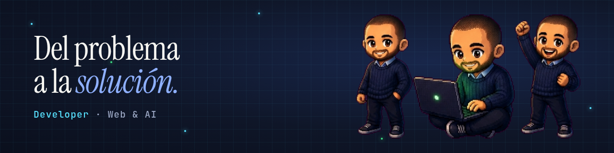
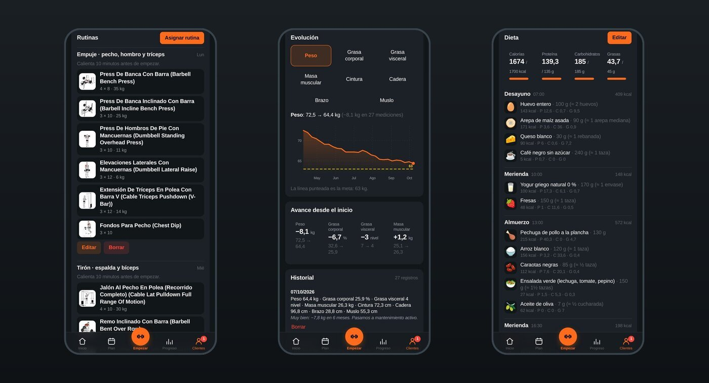
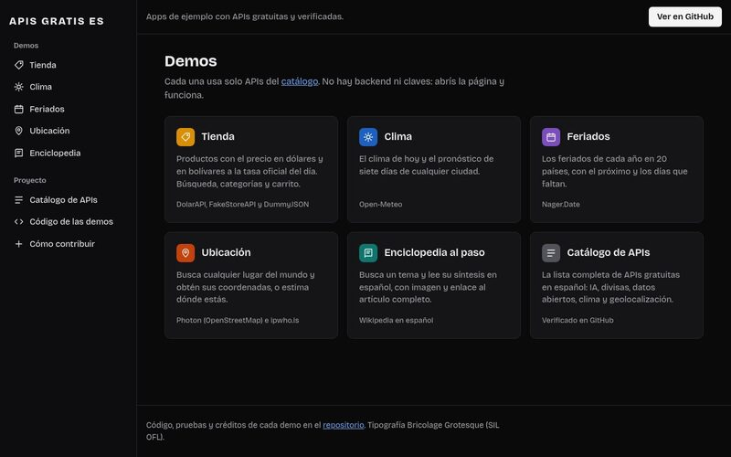
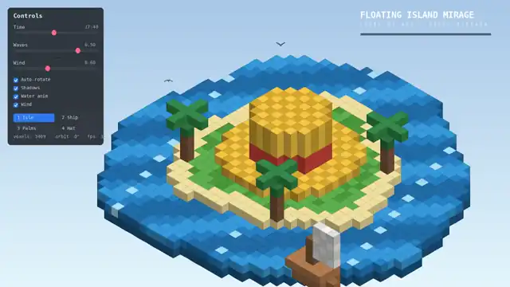
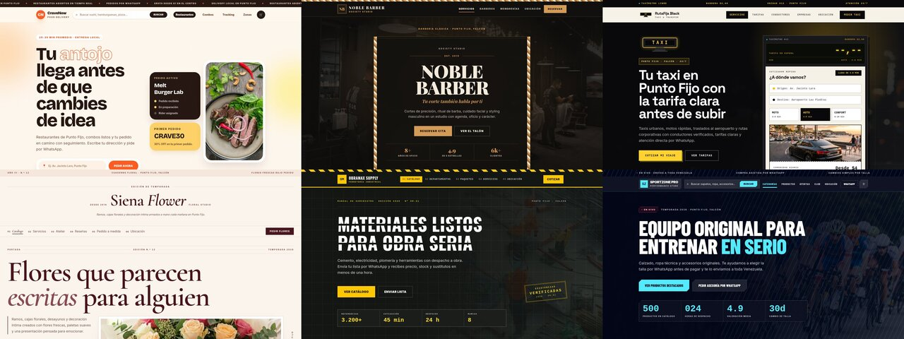

<!--
  Carlos Avila - GitHub Profile README
  Full Stack Developer · AI
-->

### Hi, I'm Carlos Avila · Full Stack Developer · AI

I build websites and apps with React, Node.js, Python and Supabase, from design to deployment. 
Tests first, and every number in my repos is measured. From problem to solution.

[**Portfolio**](https://avilacarlosdev.com) · [**LinkedIn**](https://www.linkedin.com/in/avilacarlosdev) · [**Email me**](mailto:contacto@avilacarlosdev.com)

---

## What I build

| 🌐 Websites that bring clients | 📱 Full apps in production | 🧠 AI and developer tools |
|---|---|---|
| Lead forms with spam protection, WhatsApp buttons, Meta Ads conversion tracking and leads saved in Supabase. | From idea to real users: auth, row-level security, payments and an installable PWA. | Local AI on modest hardware, MCP tooling and agent workflows, with tests and CI. |

## Featured projects

<table>
<tr>
<td align="center" width="50%">
<a href="https://github.com/AvilaCarlosDev/Forja">
 
<strong>Forja</strong></a> 
App for personal trainers and their clients, in production 
React + Supabase · 160 tests · built on <a href="https://github.com/DuarteSantos8/openGym">openGym</a> 
<a href="https://forja-trainer.vercel.app">Live app</a>
</td>
<td align="center" width="50%">
<a href="https://github.com/AvilaCarlosDev/apis-gratis-es">
 
<strong>apis-gratis-es</strong></a> 
Verified catalog of 23 free APIs for Spanish speakers + 5 live demos 
Python + JavaScript · 373 tests 
<a href="https://avilacarlosdev.github.io/apis-gratis-es/">Live site</a>
</td>
</tr>
<tr>
<td align="center" width="50%">
<a href="https://github.com/AvilaCarlosDev/polaris-local-ai">
 
<strong>polaris-local-ai</strong></a> 
Local AI stack on an AMD RX 580 8 GB: OpenAI-compatible router, 6 models, SD 3.5, Whisper 
Python + Vulkan + llama.cpp · measured benchmarks
</td>
<td align="center" width="50%">
<a href="https://avilacarlosdev.github.io/webs-para-negocios/">
 
<strong>Webs para negocios</strong></a> 
6 live website demos for local businesses 
React + Vite + Tailwind
</td>
</tr>
</table>

**More open source**

| Project | What it does | Stack |
|---|---|---|
| [mcp-readiness-check](https://github.com/AvilaCarlosDev/mcp-readiness-check) | CLI that connects to an MCP server, inspects its tools, validates their schemas and writes console, JSON and Markdown reports. 94 tests, 94% coverage. | TypeScript |
| [repo-maintenance-bot](https://github.com/AvilaCarlosDev/repo-maintenance-bot) | Local multi-repo maintenance bot: updates lockfiles, runs the tests and only commits real changes. | Bash · systemd |
| [awesome-venezuela-dev](https://github.com/AvilaCarlosDev/awesome-venezuela-dev) | Curated list of resources and communities for developers in Venezuela. | Markdown |

**Merged contributions:** [pythiaLabs](https://github.com/safal207/pythiaLabs) (6 PRs) · [DevSwitch](https://github.com/umesh-saini/DevSwitch) · [icon-sprite](https://github.com/react-zero-ui/icon-sprite)

## Client work

**Website for Dr. Eddy Hernández, bariatric surgeon (Punto Fijo, Venezuela)**, migrating from WordPress, launching soon. React + Vite site with a lead form protected by Turnstile, a WhatsApp button that asks for the form first without exposing the phone number, a thank-you page to measure Meta Ads conversions, a BMI calculator, and leads saved in Supabase with an email alert.

## How I work

Tests before code, real CI, bilingual docs (ES/EN) and numbers measured in the repo. Before coding I spent years in sales and customer service, and I studied Medicine, so I start by listening, find the real problem and explain it clearly. Today I'm also a Senior Mentor at 4Geeks Academy, where I help Full Stack students debug and review their projects.

**Stack:** JavaScript · TypeScript · React · Vite · Tailwind · Astro · Node.js · Python · Flask · PHP/Laravel · PostgreSQL · Supabase · Docker · Linux · Vercel · MCP and AI agents

## Let's work together

- **Hiring a remote full stack developer?** Write to [contacto@avilacarlosdev.com](mailto:contacto@avilacarlosdev.com) or reach me on [LinkedIn](https://www.linkedin.com/in/avilacarlosdev).
- **Need a website or app for your business?** Tell me about your business at [avilacarlosdev.com](https://avilacarlosdev.com) and I'll tell you what I'd build.

Spanish (native) · English (B1) · Italian (B1) · Remote from Punto Fijo, Venezuela · `<CA/>`
